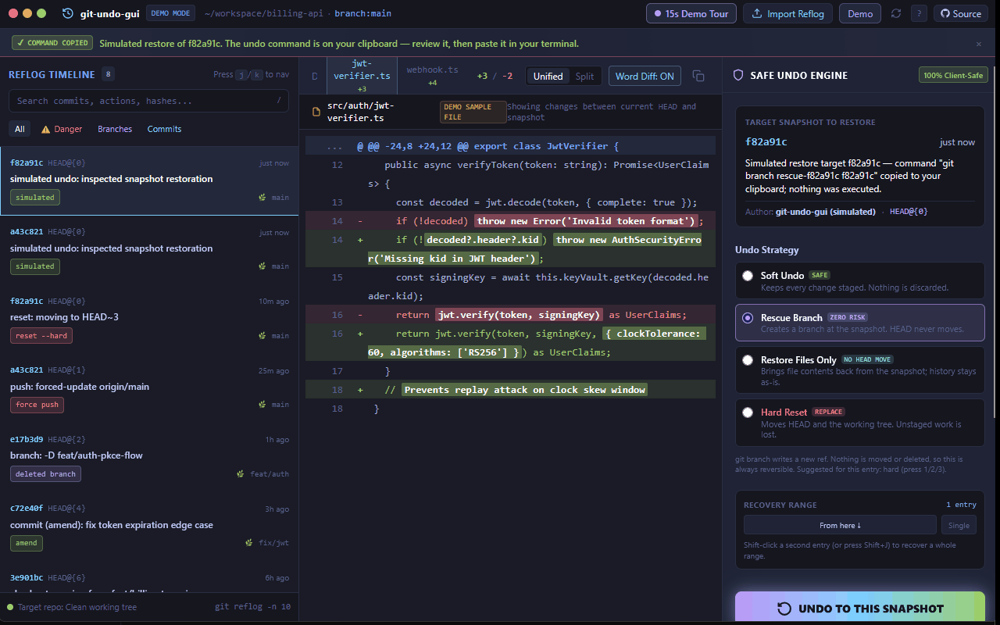
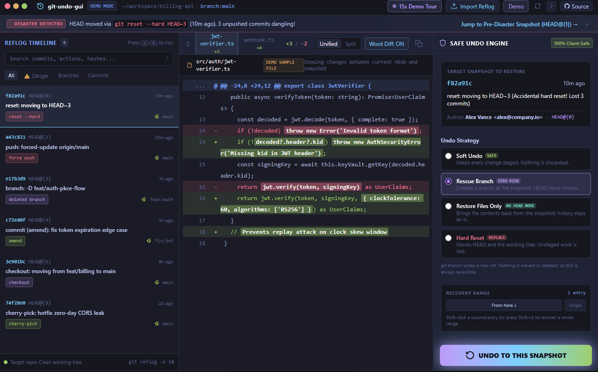

# git-undo-gui

[](LICENSE)
[](https://github.com/admos98/git-undo-gui/stargazers)
[](index.html)
[](#technical-specifications)
[](index.html)

You ran `git reset --hard` and something you needed is gone. It is still in the reflog, so the work
is recoverable — but at 2am you are reading forty hashes and guessing, and that is how the second
mistake happens. This turns the reflog into a timeline you can read, and hands you the one command
that puts things back.




## Try it

```bash
git clone https://github.com/admos98/git-undo-gui
cd git-undo-gui && open index.html    # or just double-click it

git reflog                # paste this into the import box, or:
git log -p -5             # five recent commits, with real diffs
```

Press `t` for the guided tour, or paste one of those two commands' output to work on real data.

Nothing is uploaded: no server, no account, no network call. Text is parsed in your tab and the
result stays in `localStorage`.

## Demo Status

The browser build **plans** a reset; it never executes one. It does not run git, does not open a
repository, and makes no network requests — it produces a command for you to read and run.

The desktop build in `src-tauri/` is optional and **experimental**: it can apply the reset through a
four-command, guard-checked bridge, but there are no signed installers and it has not had a real
click-through release. Treat the browser build as the product today.

## The safety model

This is the part worth reading. A reset is destructive, so it runs as four ordered steps and stops
at the first problem.

**Read state.** Branch, HEAD, dirty files, unpushed commits, any half-finished merge or rebase, and
what `backup-before-recovery` holds.

**Guard.** A pure function — no git calls, no I/O, no clock — in
[`src-tauri/logic/src/guard.rs`](src-tauri/logic/src/guard.rs), returning a refusal or a list of
risks. Being pure, its rules are unit-tested without a repository. It refuses four things: an
operation in progress (merge, rebase, cherry-pick, bisect); a hard reset that would discard
uncommitted changes to tracked files; one without the phrase typed; and a reset with nothing to do.

**Back up.** A `backup-before-recovery` branch is created at the pre-reset HEAD before anything moves.

**One command, then report.** Exactly one git command runs; the response says what changed, what it
cost, and how to undo it. Two subtleties worth stating plainly.

**Two confirmation phrases, on purpose.** `UNDO` copies a command; `RESET` runs a destructive one.
Label, placeholder, locked hint and tour all derive from one constant, so the dialog cannot ask for
one word in the field and another in the heading. Collapsing them would make the dangerous path no
harder to trigger than the harmless one.

**An existing backup branch is never overwritten.** It is idempotent, so after a second reset it may
hold last month's HEAD while its name still promises "before *this* recovery" — and following it
would jump backwards past the state you were recovering. It only counts as a way back when it points
at the current HEAD; otherwise the undo hint uses the pre-reset commit and the stale branch is named
with its date. Push recovery uses `--force-with-lease`, never `--force`.

## Strategies

| Key | Strategy | What it does |
| :-- | :--- | :--- |
| `1` | Soft reset | Moves HEAD, keeps changes staged |
| `2` | Rescue branch (default) | `git branch rescue-<hash>` — nothing moves |
| `3` | Restore files | `git restore --source=<hash> -- .` — history untouched |
| `4` | Hard reset | `git reset --hard` — needs the typed phrase |

Commands are action-aware: a stash entry gets `git stash apply`, a checkout `switch --detach`, a
branch creation `switch -c` — not a blind reset for all three.

## Keyboard

`j`/`k` move · `/` search · `1`–`4` strategy · `u` undo plan · `d` patch · `r` report · `t` tour ·
`?` help · `Esc` close — full feature list, import formats and implementation notes:
[docs/GUIDE.md](docs/GUIDE.md).

## Development

```bash
npm install && npm test    # 108 checks, jsdom against the shipped index.html
npm run dev                # local server, rebuilds CSS
npm run build              # regenerates index.html, the size badge, the embedded copy
npm run badge              # re-measure the size badge only
```

The guard rules are a dependency-free crate, testable alone:
`cd src-tauri/logic && cargo test --no-default-features`. `npm run tauri:build` produces a desktop
bundle, but treat it as experimental. CI runs the JavaScript suite on Node 20 and 22, compiles the
Rust with clippy warnings denied, and drives the reset end-to-end against throwaway repositories.

## Limits

The browser build cannot read your repository — you paste the text. That is the price of a file that
opens by double-click with no install and no permissions; for real per-file diffs you need
`git log -p` rather than `git reflog`. The desktop build removes that limit and is unsigned.

A backup branch keeps unpushed commits alive, but not on your branch — a safety net, not a time
machine, and no replacement for reading what you are about to run.

One file of 201 KB raw in total is a deliberate tradeoff: no build step, no dependency to audit, no
bundle to trust — and 3,700 lines in one place, which the jsdom suite makes safe to keep and does
not make pleasant to review.

## Similar projects

[lazygit](https://github.com/jesseduffield/lazygit) and
[git-time-machine](https://github.com/dinakars777/git-time-machine) read the repository directly and
are more capable; if you live in a terminal UI, use them. The narrow thing here is zero-install,
zero-network triage of a reflog already in your clipboard.

## Technical specifications

One `index.html`: no framework, no bundler at runtime, no dependencies, no network requests, works
from `file://`. Tokyo Night theme. Pastes up to ~2 MB are parsed in-tab and the first 200 KB kept in
`localStorage`. Keyboard-accessible throughout; `prefers-reduced-motion` respected.

## License

MIT — see [LICENSE](LICENSE).
